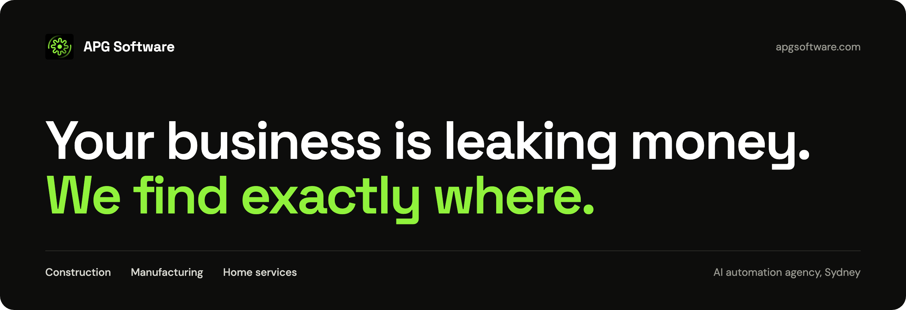
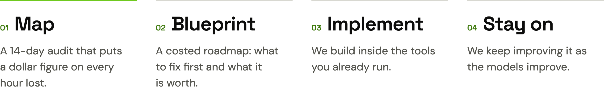

 

APG Software is an AI automation agency for construction, manufacturing and home services businesses. They quote work, run jobs and claim progress payments, and they lose hours to manual estimating, double entry and claims admin. We audit the operation, put a dollar figure on what it costs, then build AI inside the tools the team already runs.

 

## How it works

<picture>
  <source media="(prefers-color-scheme: dark)" srcset="assets/method-dark.png">
  
</picture>

If the audit does not find monthly savings worth its fee, you do not pay. The blueprint is yours either way.

 

## What we have shipped

| Agent | What it does | Result |
|:--|:--|:--|
| **Takeoff and estimating** | Reads AutoCAD or PDF drawings, pulls quantities and fills the costing sheet | A 3-week takeoff, done in hours |
| **Field quote** | Turns a voice description of the job into a priced, branded quote | Same-day quotes from the field |
| **Progress claim** | Pulls scope, hours and materials into the monthly claim | A day of admin a month, gone |
| **Rostering** | Builds the schedule from real staff, skills and geography rules | 3 to 5 hours saved a day |
| **Earn vs burn** | Links hours logged to job progress | Cost blowouts caught early |
| **Compliance** | Tracks licence and insurance expiry dates | Warned 30 days out |

We build them inside the tools clients already run, such as Simpro, Xero, Business Central and ServiceM8, as Claude plugins and skills, connectors and custom software.

 

## Why our repositories are private

Every client gets a private repository of their own. Their processes, numbers and data stay there, and are never shared between clients or published.

 

## How we work

- **Map before we build.** We document how the work runs today before we change any of it.
- **Every number traces to evidence.** No figure reaches a client unless it resolves to the audit data.
- **Fewest moving parts.** We pick the simplest option that does the job.
- **Independent review.** Nothing reaches a client until someone who did not build it has checked it.

 

---

  <a href="https://www.apgsoftware.com"><b>apgsoftware.com</b></a>&nbsp;&nbsp;&middot;&nbsp;&nbsp;<a href="mailto:info@apgsoftware.com">info@apgsoftware.com</a>&nbsp;&nbsp;&middot;&nbsp;&nbsp;Sydney, Australia

